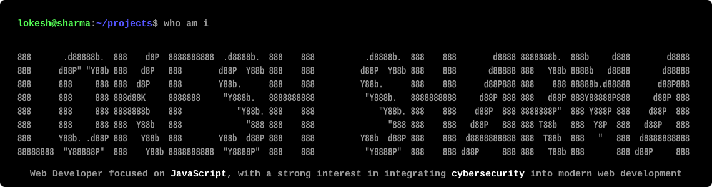

<!-- ===================== HEADER ===================== -->
<p align="center">
  
</p>

<p align="center">
  
</p>

<h1 align="center">Hi 👋, I'm Lokesh Sharma</h1>

<p align="center">
  <a href="https://github.com/L-sharma990">
    
  </a>
</p>

<p align="center">
  
  <a href="https://github.com/L-sharma990?tab=followers"></a>
  <a href="https://github.com/L-sharma990?tab=repositories"></a>
</p>

---

## 👨‍💻 A little more about me…

```js
const lokesh = {
  name: "Lokesh Sharma",
  pronouns: "he/him",
  profession: "Web Developer",
  focus: ["JavaScript", "Backend development", "Cybersecurity in web development"],
  currentlyWorkingOn: "Responsive, accessible web projects",
  currentlyLearning: ["TypeScript", "Java", "Docker", "CyberSecurity"],
  hobbies: ["Coding", "Listening to music", "Exploring new ideas"],
  strengths: ["Curiosity", "Problem solving", "Consistency"],
  funFact: "I debug with console.log and I'm not ashamed of it 😄",
  lookingFor: "Collaboration, learning and open-source work",
  motto: "Learn. Build. Break. Repeat.",
  askMeAbout: ["JavaScript", "HTML & CSS", "React", "Node.js", "Getting started in web development"],
  reachMe: "lokeshsharma5057833@gmail.com",
};
```

---

## 🛠️ Technologies I Use

<p>
  
  
  
  
  
  
  
  
  
  
  
  
</p>

---

## 🏆 Certifications

<p>
  <a href="https://www.netacad.com/">
    
  </a>
</p>

---

## 📊 GitHub Stats

<p align="center">
  
  
</p>

<p align="center">
  
</p>

---

## 🌐 Socials

<p>
  <a href="https://x.com/bhardwaj_837"></a>
  <a href="https://www.linkedin.com/in/lokesh-sharma-217531324/"></a>
  <a href="https://YOUR-PORTFOLIO-SITE.com"></a>
  <a href="mailto:lokeshsharma5057833@gmail.com"></a>
  <a href="https://github.com/L-sharma990"></a>
</p>

---

## 💬 Quote I live by

<p align="center">
  <i>"We are what we repeatedly do. Excellence, then, is not an act, but a habit."</i><br/>
  <b>— Will Durant</b>
</p>

---

<p align="center">
  
</p>
